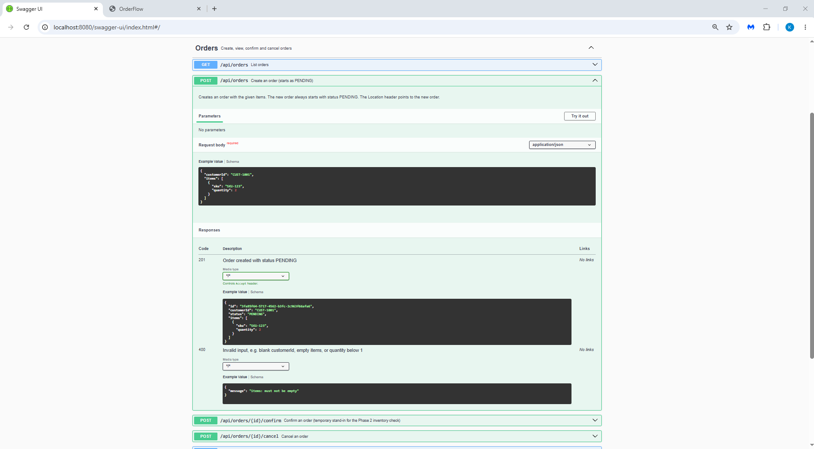
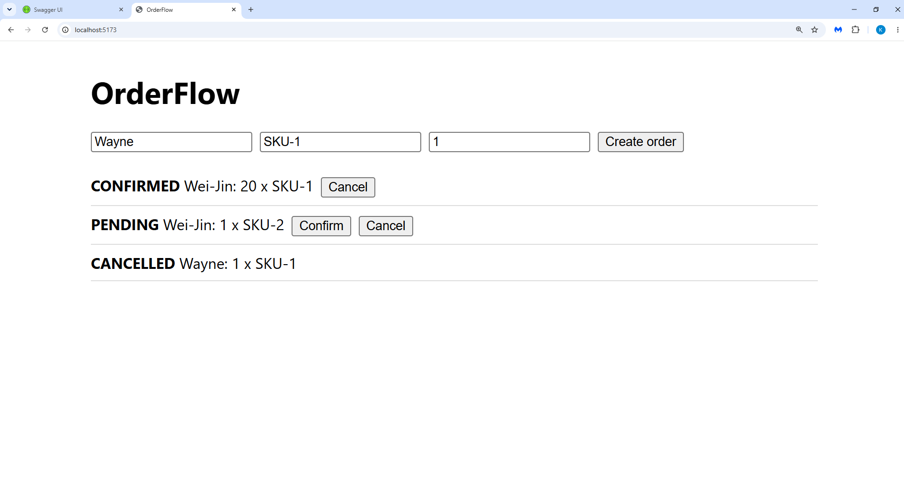

# OrderFlow

Order management web app: **React + TypeScript** UI, **Java 21 / Spring Boot** REST API documented with **Swagger**, **PostgreSQL** with Flyway migrations.
Later phases (Kafka messaging, Redis, security, Kubernetes, Terraform/AWS, load tests) are kept in [`phase2/`](phase2/README.md).

**Status 11/01: skeleton.** Build order and "done when" checks: [docs/PLAN.md](docs/PLAN.md) (start with Phase 1).

**Status 11/02: Phase 1 done.** Build order and "done when" checks: [docs/PLAN.md](docs/PLAN.md) (I used [PLAN_with_two_phases.md](PLAN_with_two_phases.md)) (Continue on with Phase 2).


## Layout
| Path | What |
|---|---|
| `services/order-service` | Spring Boot API (Swagger UI at `/swagger-ui.html`) |
| `frontend` | React + TypeScript + SCSS (Vite) |
| `infra` | docker-compose with Postgres only |
| `docs` | The plan |
| `phase2` | Everything deferred until Phase 1 works |

## Run locally (Phase 1)
## Screenshots


## Prerequisites : JDK 21, Maven, Node 22, and Docker Desktop (or local Postgres with user orderflow, password orderflow, database orders); schema will be populated through V1 and V2 scripts in order-service\src\main\resources\db\migration are executed properly - the data migration is actually carried out by Flyway.
```bash (or powershell in VS Code terminal)
docker compose -f infra/docker-compose.yml up -d        # Postgres (or: make db)
cd services/order-service && mvn spring-boot:run         # or: make backend; ***make sure V1 and V2 scripts in order-service\src\main\resources\db\migration are executed properly.
cd frontend && npm install && npm run dev                 # or: make frontend
```
## Try it:
- Swagger UI: http://localhost:8080/swagger-ui.html
- App: http://localhost:5173
- Health: http://localhost:8080/actuator/health
## Screenshots


## Phase 2 results (fill in only with numbers you measured yourself)
| Metric | Result | Setup / evidence |
|---|---|---|
| Throughput (orders/s) | _TBD_ | |
| p95 create-order latency | _TBD_ | |
| Query time before/after index | _TBD_ | `phase2/docs/perf.md` |
| Failed requests during rolling deploy | _TBD_ | |
| Orders lost/duplicated after failure drill | _TBD_ | |
| Security scan findings fixed | _TBD_ | `phase2/docs/security.md` |
