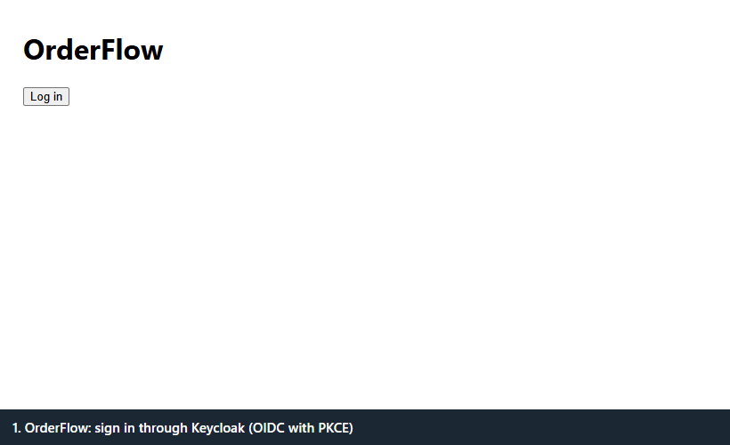

# OrderFlow

An order-management system built to show event-driven design done carefully: a **React + TypeScript** UI, two **Java 21 / Spring Boot** services
(`order-service`, `inventory-service`) that talk through **Kafka** with the **transactional outbox** pattern and **idempotent consumers**,
**PostgreSQL** with Flyway, **OAuth2/JWT** login through Keycloak, **Redis** cache with **Resilience4j**, and metrics, tracing and alerts
(Prometheus, Grafana, Jaeger).



*The demo (about 35 s, recorded by `scripts/record_demo.mjs` and `scripts/frames_to_gif.py` against the compose stack): sign in, create an order, kill inventory-service, create another order (still accepted, stays PENDING), restart it, and the order is CONFIRMED with nothing lost.*

```
browser ──REST + SSE──> order-service ──(same transaction)──> orders DB: orders + outbox
                             │ OutboxPublisher                         
                             v                                         
                       Kafka: orders.events ──> inventory-service ──(same transaction)──> inventory DB: stock + processed_messages + outbox
                             ^                                │ OutboxPublisher
                             └──── inventory.results <────────┘        (retries + dead-letter topics on both consumers)
```

An order starts `PENDING`; inventory-service reserves stock (all lines or none, once per message id) and answers `RESERVED` or `REJECTED`; order-service moves
the order to `CONFIRMED` or `REJECTED` and pushes the change to the browser. Details: [architecture](phase2/docs/architecture.md), decisions in [`phase2/docs/adr/`](phase2/docs/adr).

## Results (read the "setup / evidence" column: some numbers are from a stand-in tool or a reduced scale)
| Metric | Result | Setup / evidence |
|---|---|---|
| Throughput (orders/s) | **400 orders/s accepted with 0 failures; the API's limit is between 400 and 600** (at 600/s p95 was 1.33 s and 0.12% of requests failed). Orders reach CONFIRMED at about **220/s** once a backlog exists | One i7-14700 machine running the load generator and the whole system (services as containers) together; 30 s per step. Measured with `scripts/load_orders.py`, **not k6**. A later k6 run (2026-11-06) was clean at 50 orders/s (p95 7 to 13 ms) but intermittently slow at 300 to 800/s, so no k6 limit is claimed; see [perf.md](phase2/docs/perf.md). [perf.md](phase2/docs/perf.md#load-test-plan-step-25) |
| p95 create-order latency | about 30 ms at 50 orders/s; 28 to 42 ms from 100 to 400 orders/s | same runs |
| Outbox lag at the top rate | 19 s to drain after the 300/s step, 36 s after 400/s; peak 124 s at 1,000/s (the generator reached only 663/s there); near zero at 150/s or less | same runs |
| Query time before/after index | **about 60 ms to 0.2 ms** (19,000 to 53 buffers) for "my newest 50 orders" at **3,000,000 orders** (a customer with about 30,000 orders); measured twice with the same result | [perf.md](phase2/docs/perf.md), `scripts/seed-orders.sql` |
| Failed requests during rolling deploy | **not measured** | the AWS deploy was never run (no AWS account used); [Terraform](phase2/infra/terraform/README.md) passes `terraform validate` but was never planned or applied |
| Orders lost / duplicated after failure drills | **0 / 0** in four drills (Kafka stopped 60 s, inventory-service killed 60 s, order-service killed, at 20 orders/s; Kafka stopped 244 s at 10 orders/s, where the lag alert fired); the first three were run twice | [resilience.md](phase2/docs/resilience.md), `scripts/drill.sh`, `scripts/drill_lag_alert.py`, `scripts/drill_check.py` |
| Security scan findings fixed | 3 advisory groups from `npm audit` (all in dev tooling), now 0 vulnerabilities. CodeQL ran on PR #1: 0 results (default suites, not proof of safety). Dependabot: the 8 vite/esbuild alerts closed after PR #1 was merged; **14 are still open** (13 on Maven dependencies of `e2e/pom.xml`: jackson-databind and assertj, several high; 1 medium on a vite 6.4.3 entry in `frontend/package-lock.json`), not yet triaged | [security.md](phase2/docs/security.md) |

Verified locally (Windows 10, Docker Desktop): the three Docker images, the compose `apps` profile (also from a fresh clone), and a kind cluster
where both services became Ready ([phase2/infra/k8s/README.md](phase2/infra/k8s/README.md)).

Verified on GitHub (public repo, hosted runners): the first full CI run on the pushed branch (run `42291870099`, commit `340bfba`) passed `frontend`, both `backend` jobs, `e2e` and `kind`;
CodeQL passed on PR #1 for Java/Kotlin and JavaScript/TypeScript with 0 results (default suites, not proof of safety); PR #1 was merged into `main` on 2026-11-06, and after the merge the
full CI run on `main` (run `42338278394`) passed every job: `frontend`, both `backend` jobs, `e2e`, `kind` and the three `images` builds (the images job includes the push to GHCR; I did not open the packages page to confirm the images are there), and the CodeQL push run passed too. Branch protection is on for `main` (pull request and 7 required checks; the owner can bypass it). See [docs/ci.md](docs/ci.md).

What is not done, so nobody has to guess: `terraform plan`/`apply` and everything on AWS (`terraform validate` passes); a clean k6 limit (k6 ran, but runs at 300/s and 600/s were intermittently slow,
with the leading explanation being the local Docker disk; see [perf.md](phase2/docs/perf.md)); triage of the 14 open Dependabot alerts and of the 17 Dependabot pull requests opened against `main`
(for example the vite 8 bumps fail because `@vitejs/plugin-react` 4.7.0 does not support vite 8). The files for the unfinished parts are in the repository and are marked as untested where they are.

## Quick start

Prerequisites: Docker Desktop (or Docker Engine + the compose plugin) with about 6 GB of memory. For the development path below also JDK 21, Maven and Node 22.

### Option A: everything in containers (nothing to install except Docker)
```bash
docker compose -f phase2/infra/docker-compose.full.yml --profile apps up -d --wait --build   # about 2 min with a warm image cache
# UI: http://localhost:5173   API: http://localhost:8080/swagger-ui.html
docker compose -f phase2/infra/docker-compose.full.yml --profile apps down                   # stop (add -v to delete the data too)
```
Ports 8080, 8081 and 5173 must be free: stop any `mvn spring-boot:run` or `npm run dev` first, or compose fails with "ports are not available". To run the browser tests against these containers:
`cd frontend && npm ci && BASE_URL=http://localhost:5173 npx playwright test` (set `PW_CHANNEL=chromium` and run `npx playwright install chromium` if Microsoft Edge is not installed), and `cd e2e && mvn verify`.

### Option B: infrastructure in containers, services from source (for development)
```bash
# 1. Infrastructure: Postgres, Kafka, Redis, Keycloak, Jaeger, Prometheus, Grafana
docker compose -f phase2/infra/docker-compose.full.yml up -d --wait

# 2. The two services, each in its own terminal (inventory-service is on :8081, order-service on :8080)
cd services/inventory-service && mvn spring-boot:run
cd services/order-service && mvn spring-boot:run

# 3. The UI
cd frontend && npm ci && npm run dev          # http://localhost:5173
```

Log in at http://localhost:5173 as `alice` / `alice-dev-pw`, `bob` / `bob-dev-pw` (customers) or `ada` / `ada-dev-pw` (admin). Throwaway development passwords.

| What | Where |
|---|---|
| Swagger UI (press Authorize with a token) | http://localhost:8080/swagger-ui.html |
| Keycloak admin | http://localhost:8180 (admin / admin) |
| Grafana (OrderFlow dashboard) | http://localhost:3000 (admin / admin) |
| Prometheus, Jaeger | http://localhost:9090, http://localhost:16686 |

A token for curl: `curl -s -d client_id=orderflow-cli -d grant_type=password -d username=alice -d password=alice-dev-pw http://localhost:8180/realms/orderflow/protocol/openid-connect/token`

### Differences between Windows and Linux/macOS
- **Windows (Git Bash)**: put `MSYS_NO_PATHCONV=1` in front of `docker compose exec ... /opt/kafka/...` commands, otherwise Git Bash rewrites the path. To stop a
  service started with `mvn spring-boot:run`, find the PID with `netstat -ano | findstr :8080` and run `taskkill /F /PID <pid> /T` (in Git Bash write it as `taskkill /F ...` with `MSYS_NO_PATHCONV=1`).
- **Linux/macOS**: no path rewriting; stop a service with `kill $(lsof -ti :8080)`. Docker Engine needs your user in the `docker` group for Testcontainers.
- **Docker Engine 29 or newer**: the Testcontainers version Spring Boot 3.3 manages is too old for it; both services pin `testcontainers.version` 1.21.4 in their `pom.xml`.

### Tests
```bash
cd services/order-service && mvn verify        # unit + Testcontainers (PostgreSQL, Kafka, Redis); Docker must be running
cd services/inventory-service && mvn verify
cd frontend && npm test                         # Vitest + React Testing Library
cd frontend && npx playwright test              # browser tests; needs the stack and both services running (uses installed Edge locally, Chromium in CI)
cd e2e && mvn verify                            # HTTP end-to-end through both services
promtool: docker compose -f phase2/infra/docker-compose.full.yml exec prometheus promtool test rules /etc/prometheus/alerts_test.yml
```

### Failure drills and load
`python scripts/load_orders.py --rate 50 --duration 60` (a stand-in for the k6 script in `phase2/load-tests/k6/`), `RAMP="100 300 600" scripts/perf_run.sh <dir>`, `scripts/drill.sh kafka|inventory|order <dir>`
(works with the services as containers or started with `mvn spring-boot:run`), `python scripts/drill_lag_alert.py <dir>` (Kafka stopped 4 minutes so the `OutboxLagHigh` alert goes Pending, then Firing),
`node scripts/grafana_screenshots.mjs docs/images` (dashboard screenshots over a time window, no renderer plugin needed) and `node scripts/record_demo.mjs <dir>` with `python scripts/frames_to_gif.py <dir> docs/images/demo.gif` (the demo above).
Pipeline and CI: [docs/ci.md](docs/ci.md). Build plan and "done when" checks: [PLAN_with_two_phases.md](PLAN_with_two_phases.md).

## Layout
| Path | What |
|---|---|
| `services/order-service` | orders API, outbox publisher, inventory-result consumer, SSE stream, stock lookup with circuit breaker and Redis cache |
| `services/inventory-service` | stock reservation (idempotent, all-or-nothing), its own outbox, dead-letter replay, stock endpoint |
| `frontend` | React + TypeScript (Vite), OIDC login with PKCE, live status; Vitest and Playwright tests |
| `e2e` | HTTP end-to-end tests against the running stack |
| `phase2/infra` | docker-compose, Keycloak realm, Prometheus rules, Grafana dashboard, Kubernetes manifests, Terraform draft |
| `phase2/docs` | architecture, ADRs 0001 to 0006, security, performance, resilience |
| `scripts` | seed data, load generator, drill and check scripts, demo recording, Grafana screenshots |
