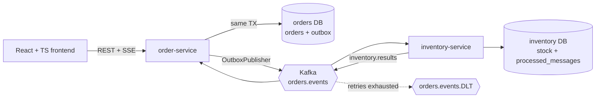

# Architecture

Order lifecycle: `PENDING -> CONFIRMED | REJECTED | CANCELLED`, `CONFIRMED -> CANCELLED`.

## Event contracts

- `orders.events`: key = order id, header `message-id` = the order-service outbox row id, value = the `OrderResponse`
  JSON (`id`, `customerId`, `status`, `items[{sku, quantity}]`).
- `inventory.results`: key = order id, header `message-id` = inventory's outbox row id, value =
  `{"orderId":"...","result":"RESERVED"|"REJECTED","reason":"..."}` (`reason` is null when reserved).
- `orders.events.DLT`: records that failed processing after the retries (step 16).

Delivery is at-least-once. The `message-id` is the outbox row id, which stays the same across every re-send of a
row (the Kafka offset does not), so consumers dedupe on it.

Fill in as built: failure modes and what happens in each.
