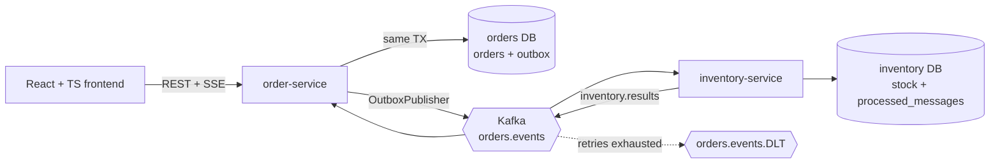

# Architecture

Order lifecycle: `PENDING -> CONFIRMED | REJECTED | CANCELLED`, `CONFIRMED -> CANCELLED`.

## Event contracts

- `orders.events`: key = order id, header `message-id` = the order-service outbox row id, value = the `OrderResponse`
  JSON (`id`, `customerId`, `status`, `items[{sku, quantity}]`).
- `inventory.results`: key = order id, header `message-id` = inventory's outbox row id, value =
  `{"orderId":"...","result":"RESERVED"|"REJECTED","reason":"..."}` (`reason` is null when reserved).
- `orders.events.DLT`: records that failed processing after the retries (step 16).

Delivery is at-least-once. The `message-id` is the outbox row id, which stays the same across every re-send of a
row (the Kafka offset does not), so consumers dedupe on it.

## Failure modes: what happens when a piece is gone
| Piece | What happens | Why it stays correct |
|---|---|---|
| Kafka | Orders are still accepted (201); they stay PENDING and `orderflow_outbox_lag_seconds` grows (1 s per second; it reached 242 s in a 244 s outage); when Kafka returns the publisher sends the waiting rows. `OutboxLagHigh` goes Pending about 90 s and Firing about 3.5 minutes into an outage | The order and its outbox row commit in one transaction; the row is marked published only after the broker acknowledged (step 13). Drills 1 and 4 in [resilience.md](resilience.md). | [See Clarifications from review of the status log (2026-11-06) in PLAN_with_two_phased.md for more explanation]
| inventory-service | Orders stay PENDING; events wait in `orders.events`; after the restart they are processed | Offsets are committed after the transaction; `processed_messages` absorbs re-deliveries (step 14). Drill 2. |
| order-service | Requests in flight fail (never acknowledged); committed rows are published after the restart | The outbox row is in the same database transaction. Drill 3. |
| A poison message | Retried with backoff, then sent to `orders.events.DLT`; the partition is not blocked; `POST /admin/dlt/replay` re-sends after a fix | `DefaultErrorHandler` + dead-letter recoverer (step 16, ADR 0004). |
| Redis | The stock lookup still answers, about 1 s slower; nothing else uses Redis | `CacheErrorHandler`, 500 ms timeouts, health indicator off (step 17c, ADR 0005). |
| inventory-service for the stock lookup | `available` is `null` ("unknown" in the UI), fast; the circuit breaker opens after 5 failures | Resilience4j (step 17b). Not part of order creation. |
| Keycloak | Existing sessions fail at token expiry; services keep validating tokens with the cached signing keys; no new logins | Resource server validates locally. |
| Load above what one order-service can take (about 400 orders/s on the test machine; 600/s gave p95 1.3 s and a few client timeouts) | Latency rises and some requests time out (never acknowledged); accepted orders still reach CONFIRMED, but only at about 220 orders/s once a backlog exists, so PENDING orders pile up and drain afterwards (about 2 minutes after a 30 s step at 1,000/s) | The outbox and the idempotent consumer do not depend on the rate. Which stage limits the 220/s was not isolated. [perf.md](perf.md). |
| Two order-service instances | Both publish the same outbox rows; events are duplicated on the topic | Idempotent consumer. Known limit: `FOR UPDATE SKIP LOCKED` would remove it. |
| The browser's SSE connection | Reconnects by itself; the UI refetches the list; missed events are not replayed | Statuses only move forward, so a pushed status wins over an older list. |

Topics: `orders.events` (+ `.DLT`), `inventory.results` (+ `.DLT`). Authentication: Keycloak realm `orderflow`; the owner of an order is the token's `sub`.
