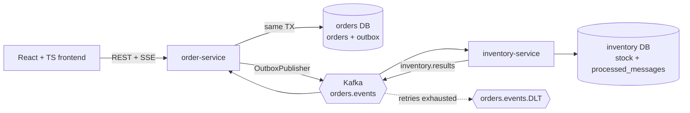

# Architecture

Order lifecycle: `PENDING -> CONFIRMED | REJECTED | CANCELLED`, `CONFIRMED -> CANCELLED`.

## Event contracts

- `orders.events`: key = order id, header `message-id` = the order-service outbox row id, value = the `OrderResponse`
  JSON (`id`, `customerId`, `status`, `items[{sku, quantity}]`).
- `inventory.results`: key = order id, header `message-id` = inventory's outbox row id, value =
  `{"orderId":"...","result":"RESERVED"|"REJECTED","reason":"..."}` (`reason` is null when reserved).
- `orders.events.DLT`: records that failed processing after the retries (step 16).

Delivery is at-least-once. The `message-id` is the outbox row id, which stays the same across every re-send of a
row (the Kafka offset does not), so consumers dedupe on it.

## Idempotent consumer: how inventory-service ignores duplicates

Duplicate `OrderCreated` messages are expected: the outbox publisher can re-send a row (crash before
`markPublished()`, or two order-service instances during a rolling deploy), and the listener's offset is committed only
after it returns, so a crash between the database commit and the offset commit re-delivers the record
([OrderEventsListener.java](../../services/inventory-service/src/main/java/com/orderflow/inventory/messaging/OrderEventsListener.java)).
inventory-service still reserves stock once per order:

1. **The id is stable across re-sends.** order-service sets the `message-id` header to the outbox row id
   ([OutboxPublisher.java](../../services/order-service/src/main/java/com/orderflow/order/outbox/OutboxPublisher.java)),
   so every copy of one event carries the same id.
2. **The first statement claims the id.** `InventoryService.reserve` runs
   `INSERT INTO processed_messages (message_id) VALUES (?) ON CONFLICT DO NOTHING`. `message_id` is the primary key
   ([V1__init.sql](../../services/inventory-service/src/main/resources/db/migration/V1__init.sql)), so 1 row inserted
   means first delivery and the reservation goes ahead; 0 inserted rows means the copy is logged ("already processed; duplicate
   ignored") and skipped without touching stock
   ([InventoryService.java](../../services/inventory-service/src/main/java/com/orderflow/inventory/service/InventoryService.java)).
3. **The claim and the stock change commit together.** `reserve` is `@Transactional`: the `processed_messages` row,
   the stock decrement, the `reservations` rows and the result outbox row all commit or roll back as one. There is no state
   where stock moved but the id was not recorded, or the reverse.
4. **Concurrent copies are covered too.** If two copies are processed at the same time, the second insert waits on the
   primary key until the first transaction ends, then inserts 0 rows and is skipped.

Strictly the guarantee is once per message id, not per order id. It works out as once per order because each order
produces one `OrderCreated` outbox row; a second, different message for the same order would fail on the
`reservations` primary key `(order_id, sku)` rather than reserve twice.

Seen on AWS (2026-11-14, [ADR 0006](adr/0006-aws-choices.md)): during the deploy under load inventory-service ignored
541 duplicate `OrderCreated` messages and reserved stock once for each of the 12,001 orders.

order-service's result handler needs no such table: "apply only if PENDING" gives the same final state when repeated
([ADR 0003](adr/0003-order-status-from-inventory.md)).

## Duplicate publishes during a rolling deploy: why order-service received 12,113 results for 12,001 orders

In the deploy under load on AWS (2026-11-14, [aws-deploy-under-load.md](aws-deploy-under-load.md)) order-service
received 12,113 inventory results for 12,001 orders: the old and new inventory-service tasks both published the same
112 `StockReserved` outbox rows between 18:35:50 and 18:36:03, and 12,001 + 112 = 12,113.

Why two tasks send the same rows: the outbox publisher does not lock the rows it picks up
([inventory-service OutboxPublisher.java](../../services/inventory-service/src/main/java/com/orderflow/inventory/outbox/OutboxPublisher.java)).

1. Every 500 ms it runs `findTop100ByPublishedAtIsNullOrderByCreatedAt()` in one transaction, a plain read with no
   `FOR UPDATE`.
2. For each row it sends to `inventory.results`, then sets `published_at`.
3. Those `published_at` updates commit only when the whole batch ends.

With `maximum_percent = 200` ECS starts the new task before stopping the old one, and both use the same database. Until
one task's batch commits, the other still sees those rows as unpublished and sends them too. The old task ran until
18:36:03 and the new one from 18:34:54, so only rows that both tasks read before either committed were sent twice, not
every row created in the overlap. Why the duplicates start at 18:35:50 rather than 18:34:54 was not checked; the time
Spring took to start before the publisher began polling is a likely cause.

Why it was harmless: the copies keep the same `message-id`, but order-service does not dedupe on it. Its result handler
applies a result only to a PENDING order ([ADR 0003](adr/0003-order-status-from-inventory.md) decision 3), so each
second copy found the order already CONFIRMED and was logged and ignored.

It is the same cause as the 541 duplicate `OrderCreated` events one service further back: order-service's outbox
publisher has the same unlocked read, and its old and new tasks overlapped for about a minute. inventory-service
absorbed those with `processed_messages` (section above).

`FOR UPDATE SKIP LOCKED` on the select would stop the duplicates in both services, because each task would skip rows
the other has locked. Not applied (see the "Two order-service or inventory-service instances" row below).

## Failure modes: what happens when a piece is gone
| Piece | What happens | Why it stays correct |
|---|---|---|
| Kafka | Orders are still accepted (201); they stay PENDING and `orderflow_outbox_lag_seconds` grows (1 s per second; it reached 242 s in a 244 s outage); when Kafka returns the publisher sends the waiting rows. `OutboxLagHigh` goes Pending about 90 s and Firing about 3.5 minutes into an outage | The order and its outbox row commit in one transaction; the row is marked published only after the broker acknowledged (step 13). Drills 1 and 4 in [resilience.md](resilience.md). | [See Clarifications from review of the status log (2026-11-06) in PLAN_with_two_phased.md for more explanation]
| inventory-service | Orders stay PENDING; events wait in `orders.events`; after the restart they are processed | Offsets are committed after the transaction; `processed_messages` absorbs re-deliveries (step 14). Drill 2. |
| order-service | Requests in flight fail (never acknowledged); committed rows are published after the restart | The outbox row is in the same database transaction. Drill 3. |
| A poison message | Retried with backoff, then sent to `orders.events.DLT`; the partition is not blocked; `POST /admin/dlt/replay` re-sends after a fix | `DefaultErrorHandler` + dead-letter recoverer (step 16, ADR 0004). |
| Redis | The stock lookup still answers, about 1 s slower; nothing else uses Redis | `CacheErrorHandler`, 500 ms timeouts, health indicator off (step 17c, ADR 0005). |
| inventory-service for the stock lookup | `available` is `null` ("unknown" in the UI), fast; the circuit breaker opens after 5 failures | Resilience4j (step 17b). Not part of order creation. |
| Keycloak | Existing sessions fail at token expiry; services keep validating tokens with the cached signing keys; no new logins | Resource server validates locally. |
| Load above what one order-service can take (about 400 orders/s on the test machine; 600/s gave p95 1.3 s and a few client timeouts) | Latency rises and some requests time out (never acknowledged); accepted orders still reach CONFIRMED, but only at about 220 orders/s once a backlog exists, so PENDING orders pile up and drain afterwards (about 2 minutes after a 30 s step at 1,000/s) | The outbox and the idempotent consumer do not depend on the rate. Which stage limits the 220/s was not isolated. [perf.md](perf.md). |
| Two order-service or inventory-service instances (briefly, in every rolling deploy) | Both publish the same outbox rows; events are duplicated on the topic (seen on AWS: 541 `OrderCreated`, 112 `StockReserved`) | Idempotent consumer in inventory-service; "only if PENDING" in order-service. Known limit: `FOR UPDATE SKIP LOCKED` would remove it. |
| The browser's SSE connection | Reconnects by itself; the UI refetches the list; missed events are not replayed | Statuses only move forward, so a pushed status wins over an older list. |

Topics: `orders.events` (+ `.DLT`), `inventory.results` (+ `.DLT`). Authentication: Keycloak realm `orderflow`; the owner of an order is the token's `sub`.
